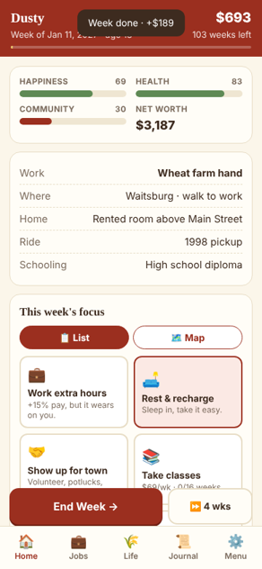
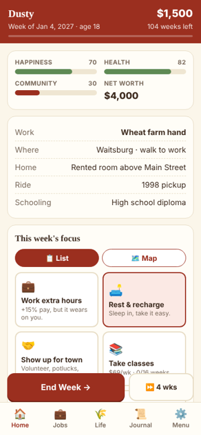
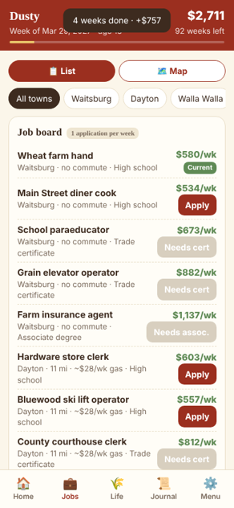
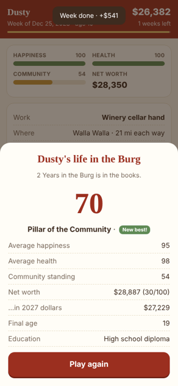

# Playtest report: The Burg 0.1.0-beta.3

_November 17, 2026 · tested on a phone-sized screen (390 × 844) with touch, in headless Chrome_

## How it was tested

- **New player walkthrough:** title → new 2-year game → Jobs → applied → Home → 8 weeks with End Week → ⏩ 4 weeks
  → every tab → the Waitsburg map → the rest of the game with End Week only → ending screen. Screenshots of
  each step, every tap counted.
- **"Do nothing" check:** a bot that only ends weeks (keeps the default Rest focus, takes the first choice on every
  event) played 16 games across all four lengths.
- **Tap-target check:** measured the buttons and map pins on the Home screen against the 44 × 44 px guideline.

No errors or crashes came up. The findings are about balance, feedback and flow.

## What works well

- Getting started is quick: name, length, Start, and you land on the Jobs tab with a nudge to find a job.
- Events read well, are short, and are local (truck trouble, neighbor's moving day, windstorm).
- Skips stop when something happens, so you don't miss anything.
- The ending screen is clear, and "New best!" is a nice touch.

## Findings, in priority order

### P1. Doing nothing scores too well

A player who only taps End Week (the default focus is Rest) scores **64–76**: higher than the random-play bot (58)
and close to the good-play bot in short games. Resting every week pushes happiness and health to 100 and keeps
them there. In the walkthrough, a farm hand who never changed focus finished a 2-year game with average
happiness 95, health 98 and a score of 70 ("Pillar of the Community").

**Suggest:** diminishing returns for repeating the same focus ("You've rested 6 weeks running: you're getting
restless"), Rest that tops out around 80 instead of 100, and an "idle" bot in the simulation with a target of
**50 or below**.

### P1. You can't see what a week did

- After End Week, the only feedback is a toast for about 2 seconds, and it covers the header (name, date and
  money).
- Stat changes aren't shown anywhere. The "Last week" breakdown is at the bottom of the Home screen, below the fold.
- The toast counts only paychecks and bills. In the walkthrough it said "Week done · +$189", then truck repairs
  cost $996 in an event right after. Cash went from $1,689 to $693 with no combined total.

**Suggest:** a "This week" strip right above End Week showing the net money (events included) and ▲▼ for each
stat. Tapping it opens the full breakdown. Move the toast below the header.

### P1. The weekly decision is below the fold

- On a phone, the focus picker starts about halfway down the screen (451 px), and the End Week bar covers its
  second row. Most of the first screen is the Work / Where / Home / Ride / Schooling card, which rarely changes.
- The focus you picked carries over silently, so it's easy to forget you're still on "Rest".

**Suggest:** put the six focus choices right under the stats as a compact icon grid. Shrink the Work / Home / Ride
card to one summary line that links to the Life tab. Show the current focus on the button: **End Week ·
🛋️ Rest →**.

### P1. Longer games take a lot of taps

- A 2-year game took about **180 taps** with End Week. There were about 34 events, and each one takes two taps
  (choice, then Continue).
- The ⏩ 13-week skip only shows in 5-year and Lifetime games, so 2-year games only get ⏩ 4 weeks.

**Suggest:** show ⏩ 13 weeks in 2-year games too. Add an "auto-play until something needs me" option. For events
with a single choice, show the result in a toast instead of a second sheet.

### P2. New players get no guidance after the first job

- After you're hired, nothing explains focus, End Week or skips. The How to play text sits on the title screen.
- Locked jobs show a grey "Needs cert" button that does nothing when tapped. It doesn't tell you that "Take
  classes" on Home unlocks it, or how long that takes (16 weeks, $70/wk).

**Suggest:** three one-time tips (pick a focus → End Week → check Jobs and Life). Tapping a locked job explains how
to unlock it and offers to make "Take classes" this week's focus.

### P2. The stats and score don't explain themselves

- Nothing tells you what raises Community or Health. Tapping a stat does nothing.
- There's no warning when a stat gets low, only the bar turning red.
- The ending shows raw averages (happiness 95, health 98), but the score uses rescaled parts. The numbers don't
  add up to the 70 in any way a player could follow.
- At the start, Net worth shows $4,000 while cash is $1,500, because the truck counts. Nothing says so.

**Suggest:** tap a stat for a short "what moves this" note. A banner when happiness or health drops below 30, with
a suggested focus. The ending lists the four score parts out of 100 with their weights. Label it "Net worth
(cash + home + truck + 401(k))".

### P2. The job list is long and hard to compare

- All 25 jobs are in one list, and locked jobs are mixed in with ones you can apply for.
- Pay is shown before gas, so long commutes look better than they are. It's hard to compare against what your
  current job brings home.

**Suggest:** jobs you can apply for first, a "Can apply" filter, and "take-home after gas" per job, with
▲/▼ against your current job.

### P2. Long games need a sense of progress

In 5-year and Lifetime games, the weeks blur together. Nothing marks a year passing except birthdays every 10 years.

**Suggest:** a short "2027 in review" card each New Year: money in and out, stat trends and milestones (hired,
graduated, moved, kids).

### Smaller notes

- Map pins (25–35 px wide), the List/Map toggle (36 px tall) and the 11 px tags are below comfortable tap and
  reading sizes. Added to the accessibility issue.
- Truck trouble on a $2,500 pickup can cost up to $1,400, with no other option when Community is low. It could
  offer "scrap it and buy a used sedan". Added to the local-content issue.
